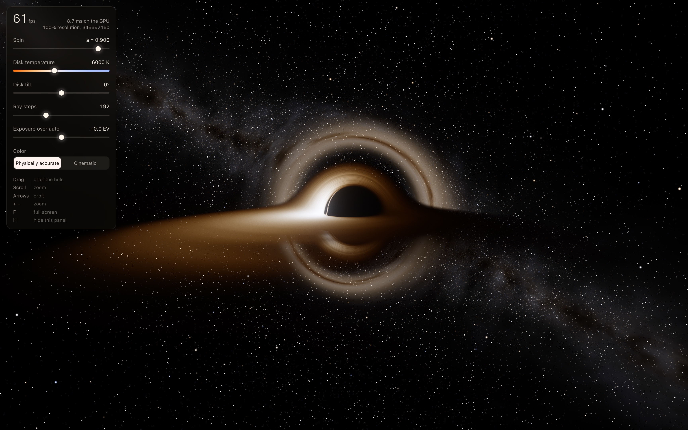

# Kerr black hole

A real-time renderer of a spinning black hole, written in raw WebGPU as one self-contained `index.html`: no engine, no libraries, no build step.

**Live:** https://kerr-black-hole-roan.vercel.app (every push to `main` deploys there automatically)

Every pixel follows its light ray backwards through the curved space around a spinning (Kerr) black hole. The dark shadow, the thin photon ring, the far side of the disk arching over and under the hole, and the warped stars all come out of that ray tracing, not from a painted-on effect.

## Open it

- Online: the link above, in Chrome.
- Locally: download `index.html` and open it in Chrome. It needs no server and makes no network requests.
- Safari: WebGPU is on by default in Safari 26 on macOS 26. Older Safari needs the WebGPU feature flag (Develop › Feature Flags). Safari is not yet tested.

## Controls

| Input | Action |
|---|---|
| Drag, or arrow keys | Orbit the hole |
| Scroll, pinch, or `+` `−` | Move closer or farther |
| `F` | Full screen |
| `H` | Show or hide the settings panel |

The settings panel sets spin, disk temperature, disk tilt, ray steps and exposure, switches between physically accurate and cinematic color, and shows the frame rate.

## What it simulates

- Light rays stepped along Kerr geodesics per pixel, with fewer steps far from the hole and early stopping once a ray escapes or falls in.
- A thin, hot accretion disk: Page–Thorne temperature profile, blackbody color, Doppler beaming (brighter on the side moving toward you), gravitational redshift, and turbulence that turns faster near the inner edge.
- A lensed starfield and Milky Way band, including the Einstein ring.
- HDR bloom, filmic (AgX) tone mapping and light film grain.
- Dynamic resolution: the expensive ray tracing runs at a lower resolution when needed to hold 60 fps.

## Checks

`tools/` holds a headless-Chrome harness. It runs a physics self-test (the GPU rays against double-precision references and the exact shadow outline), an input test, screenshots of fixed views, and frame-time benchmarks. See [tools/README.md](tools/README.md). Run `npm install` in `tools/` first; it needs Google Chrome installed.

## Analytics

The deployed site loads Vercel Web Analytics. The script loads only when the page is served over HTTPS, so opening the file locally stays offline.
